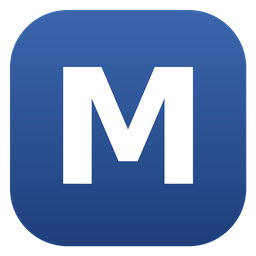

<div align="center">



# Marchand Studio

**The all-in-one desktop AI studio for your own PC.**
Chat, code, make pictures and *train your own local AI* with Claude, Grok or any model you like, all from one window.

[](https://buymeacoffee.com/ilusixne)
[](LICENSE)


**[Support the project: buymeacoffee.com/ilusixne](https://buymeacoffee.com/ilusixne)**

</div>

---

## What is Marchand Studio?

Marchand Studio is a desktop application that puts every kind of AI you use into **one calm, fast interface**, and adds something most chat apps do not
have: a built-in **school for your own local AI**.

You can:

- **Talk** to local models (Ollama, LM Studio, Jan, KoboldCpp, llama.cpp, vLLM and more) and to cloud models (Claude, ChatGPT, Grok, Gemini, DeepSeek,
  Mistral, Groq, OpenRouter and many others) from the same chat box.
- **Use your Claude subscription directly**: Opus, Sonnet, Fable and Haiku with a Low to Max effort selector and live plan-usage meters, through the
  Claude Code program you already have. No API key needed.
- **Code with an agent** that reads your project, plans, edits files with visible diffs, runs your tests, reviews its own work, and asks before every
  change.
- **Generate pictures** with Forge, Automatic1111, SD.Next, ComfyUI or cloud image models.
- **Understand images, documents and videos**: drag in screenshots, PDFs, Word/Excel/PowerPoint files, zip archives, whole folders or videos.
- **Train a small local AI to be better**, with a stronger AI (Claude, Grok, anything) acting as its teacher, then **save the result as your own AI**.
- **Learn reverse engineering** in a dedicated school with real, test-verified exercises.

Everything runs on your computer. Your chats, files and trained AIs stay in a folder on your PC (`~/.marchand`).

---

## Highlights

### One chat for every AI
- A model picker under the message box, like Claude Desktop: **All / My AI / Claude / Local / Cloud**.
- Shows 6 models, then **Show more models**: a library of 70+ downloadable local models with size, a "runs great / runs slower / too big for this
  PC" label, a Download button and a link to its page on ollama.com, plus links to every Ollama and Hugging Face model.
- **Popular AIs** (ChatGPT, Grok, Gemini, Claude API, DeepSeek, Mistral, Groq, OpenRouter) listed right in the picker: paste a key, press Connect, done.
- Any AI you add, from a key or a local program, is **toggleable in the chat automatically**.
- Every AI you train and save appears under **My AI** automatically.

### Claude on your subscription
- Picks up the Claude Code program automatically (normal install folders, Claude Desktop's bundled copy, the VS Code extension) or via a
  **Search this PC for AI agents** button that also looks for Codex CLI, Gemini CLI, Aider, Goose and opencode.
- **Effort selector** from Low to Max, a context meter and **plan usage meters** (5-hour session, weekly limit, extra-usage status) in the side panel.
- Edits and commands from Claude appear as the same **approval cards** as every other model.

### A coding agent you can trust
- Plans, reads, edits, runs tests and refuses to finish work it did not verify.
- **Approval cards** for every edit and command, with full-file diffs. Dangerous commands are blocked.
- A review pass that checks its own diff, a verify gate, per-project rules (`MARCHAND.md`), a git-aware **side panel** (environment, context,
  outputs, changes with +/- counts and commit, and a per-conversation file store).
- Work across several folders with **+ > Add folder**.

### Make your own AI (Training)
The Training tab is the heart of the app.

- **Train with Claude**: choose your local AI (the *student*) and a *teacher* (Claude on your subscription, Grok, or any model with a key) and press
  **Start teaching**. Your AI attempts real coding tasks in a sandbox folder, the **tests decide pass or fail**, and the teacher reviews every failure,
  writes lessons and shows a worked solution. Press **Save AI** at the end to get a new model with those lessons and examples built in.
- Every teacher is briefed that it is teaching a smaller AI and how to teach it well.
- **62 built-in tasks with real tests** in Python, JavaScript, TypeScript, C, C++, C#, Java, Go, Rust, PHP, Ruby, Perl, Lua, Bash and SQL, plus
  **9 reverse-engineering tasks**. Tasks whose toolchain is missing on your PC are greyed out, never faked.
- **Marchand Coder**: a ready-made local coding AI built from the best Ollama coder your PC runs well, with 90 expert rules across 15 languages,
  verified worked examples and a careful engineering persona.
- **Marchand Reverser**: the same idea for reverse engineering only.
- **Add your own model**: download from Ollama or Hugging Face, import a `.gguf` file, or connect any program that offers an OpenAI-style address.
- **Your own tasks**: turn any of your projects into a training task with your own test command.
- **GPU fine-tuning** (NVIDIA): real LoRA fine-tuning with Unsloth, exported to GGUF and imported into Ollama automatically.

### Reverse engineering school
A tab dedicated to understanding things nobody documented: file formats, network protocols, assembly listings, bytecode, obfuscated code and
black-box programs. The method: observe real samples, form a hypothesis, test it on every sample, peel encodings one layer at a time, read assembly by
role, then re-implement and compare. Educational and defensive use only: your own files, interoperability, data recovery, CTF and sandboxed triage.

### Pictures, video and documents
- **Images** tab for Forge, Automatic1111, SD.Next, ComfyUI and cloud image models, with prompt improvement by AI and a gallery.
- Attach images, **videos** (sent as timestamped frames), text and code, Word, PowerPoint, Excel, OpenDocument, zip archives and PDFs (with `pdftotext`).
- **Drag and drop anywhere** in Chat or Code. Dropping a folder shows one folder chip; the AI receives the file list and the contents of text files.
- A **vision helper** describes images and videos for AIs that cannot see them.

### Plugins and connectors
- **Plugins**: slash commands, skills, tools and rules you can switch on or off.
- **Connectors (MCP)**: add MCP servers, test them and toggle them from the **+ menu**; link with Claude Desktop's connectors.

### AMD, NVIDIA, Apple and CPU
- Detects **AMD Radeon** cards. Ollama uses ROCm on supported cards or its experimental Vulkan mode; LM Studio and KoboldCpp run on AMD through Vulkan.
- Image generators link to AMD builds (DirectML / ZLUDA / ROCm) when a Radeon card is found.
- Only GPU fine-tuning needs NVIDIA. Everything else works on any PC.

### Desktop-native
- A proper **Windows installer** with its own bundled Python and a `MarchandStudio.exe` launcher.
- The **M logo in the system tray** (hidden icons): closing the window keeps Marchand running, right-click for Open / Quit.
- Missing a program? Download links for Ollama, LM Studio, Forge, Automatic1111, ComfyUI, InvokeAI, ffmpeg, Git and more appear right where you need them.

---

## Install

### Windows (recommended)
1. Download **[MarchandStudio-Setup.exe](downloads/MarchandStudio-Setup.exe?raw=1)** (about 7.7 MB), or build it yourself (see below).
2. Run it, accept the license and press Install. No administrator rights needed.
3. Start **Marchand Studio** from the Desktop or Start menu.

Windows SmartScreen may warn about an unsigned installer: choose **More info**, then **Run anyway**.

Optional but recommended:
- **Ollama** (ollama.com) for local models.
- **Claude Code** (claude.ai/code): install it, run `claude` once in a terminal and log in. Claude Desktop alone is not enough.
- **ffmpeg** (`winget install ffmpeg`) so AIs can analyse videos.

### From source (Windows, macOS, Linux)
```bash
git clone <this repository>
cd marchand-studio
python3 app.py          # or: python3 server.py   (opens in your browser)
```
Python 3.9 or newer is the only requirement; there are no third-party Python packages to install.

### Build the Windows installer yourself
On Linux with `mingw-w64` and `nsis` installed:
```bash
sh installer/build.sh
```
This bundles Python 3.12, the app and a small launcher, and produces `installer/MarchandStudio-Setup.exe`.

---

## How training works (in plain words)

1. Pick your local AI (the student) and a teacher.
2. The student tries real tasks inside a sandbox folder. The task's tests give an honest pass or fail.
3. For each failure the teacher explains what went wrong, writes a short lesson and demonstrates a solution.
4. The student tries again with the lessons and examples. You see the before and after pass rate.
5. Press **Save AI**: Marchand creates a new Ollama model that carries a careful persona, the condensed lessons and a few worked examples.

**Honest limits:** this changes the model's *instructions, lessons and examples*, not its weights. A small local model gets better habits and better
results on tasks like the ones it practised, but it does not become Opus. Only **GPU fine-tuning** changes weights. For the strongest results, pick
Claude on your subscription directly. Claude requests count against your plan limits.

---

## Safety and privacy

- A random per-session token protects the local server; only `127.0.0.1` is used, with Host and Origin checks.
- File access is sandboxed to your project folder (plus folders you explicitly add). Dangerous commands are blocked and everything else asks first.
- Training runs code written by AIs inside a sandbox folder under `~/.marchand/training`. Only train with models you trust.
- Nothing is sent anywhere except to the AI services and download sites you choose to use. API keys are stored locally.

---

## Tests

`tests/run_all.sh` starts fake servers (Ollama, OpenAI-style, Anthropic-style, a fake Claude Code program that speaks the real stream-json and
permission protocol, Forge, ComfyUI, LM Studio, an MCP server, a fake GPU trainer) and runs the API suites plus a browser run through every page.
It also verifies every training task fails before and passes after its reference solution.

Not covered by the automated tests: real Ollama, real cloud accounts, real Forge/ComfyUI builds, the native Windows shell (tray icon appearance,
SmartScreen), the Ollama updater and real GPU fine-tuning.

---

## Project layout

| Path | What it is |
| --- | --- |
| `app.py`, `tray.py`, `winquiet.py` | Desktop shell: window, tray icon, hidden child consoles |
| `server.py` | Local web server and all API endpoints |
| `engine.py` | The coding agent loop and its tools |
| `claude_code.py`, `agents.py` | Claude Code bridge and the AI-agent finder |
| `trainer.py`, `teacher.py`, `pack.py`, `curriculum*.py` | Training loop, teacher briefing, expert rules, 71 verified tasks |
| `ollama_mgr.py`, `providers.py`, `software.py` | Model catalog, hardware detection, providers, app links |
| `images.py`, `finetune.py`, `extract.py`, `plugins.py` | Pictures, GPU fine-tuning, document text, plugins and MCP |
| `knowledge/` | Guides the models read: tools, debugging, testing, review, reverse engineering and one per language |
| `web/` | The interface |
| `installer/` | Windows launcher and NSIS installer sources |
| `tests/` | Mock servers, API suites and the browser test |

---

## License

Marchand Studio is **source-available** under the **[PolyForm Noncommercial License 1.0.0](LICENSE)**.

**You may** use it, read it, change it and share it for any **non-commercial** purpose (personal use, learning, research, hobby projects, charities,
schools).

**You must** keep the copyright and `Required Notice` lines (see [`NOTICE`](NOTICE)) with every copy, and give anyone you share it with the license
terms.

**You may not** sell it, bundle it into a paid product or use it commercially without the author's written permission. Contact the author for a
commercial license.

The **name "Marchand Studio" and the M logo are not part of the license**: a fork or modified copy must use its own name and logo and say it is based on
Marchand Studio (see [`TRADEMARK.md`](TRADEMARK.md)).

Copyright (c) 2026 ilusixne. The bundled Python in the Windows installer is licensed under the Python Software Foundation License (included with it).

> This is not legal advice. The license is the official, unmodified PolyForm Noncommercial 1.0.0 text.

---

## Support the project

Marchand Studio is built and maintained by one person. If it saves you time, a coffee keeps it going.

<div align="center">

[](https://buymeacoffee.com/ilusixne)

</div>

Forks and redistributions must keep the credit lines in [`NOTICE`](NOTICE), which include this support link.

---

## Contributing

Issues and pull requests are welcome. See [`CONTRIBUTING.md`](CONTRIBUTING.md). By contributing you agree that your contribution is licensed under the
same PolyForm Noncommercial terms and that the author may also offer the project under commercial terms.
